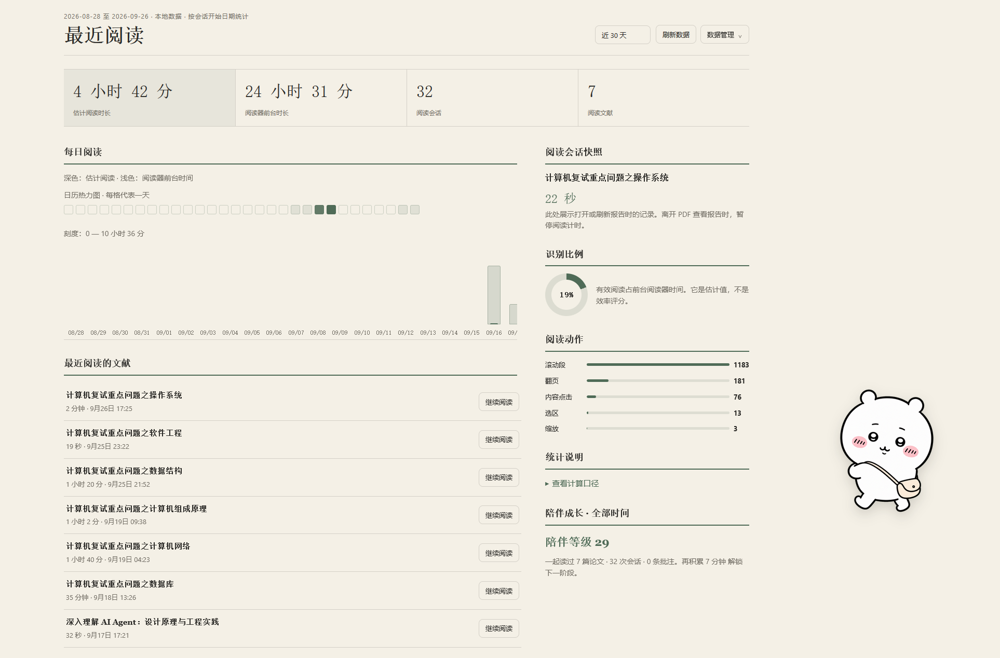
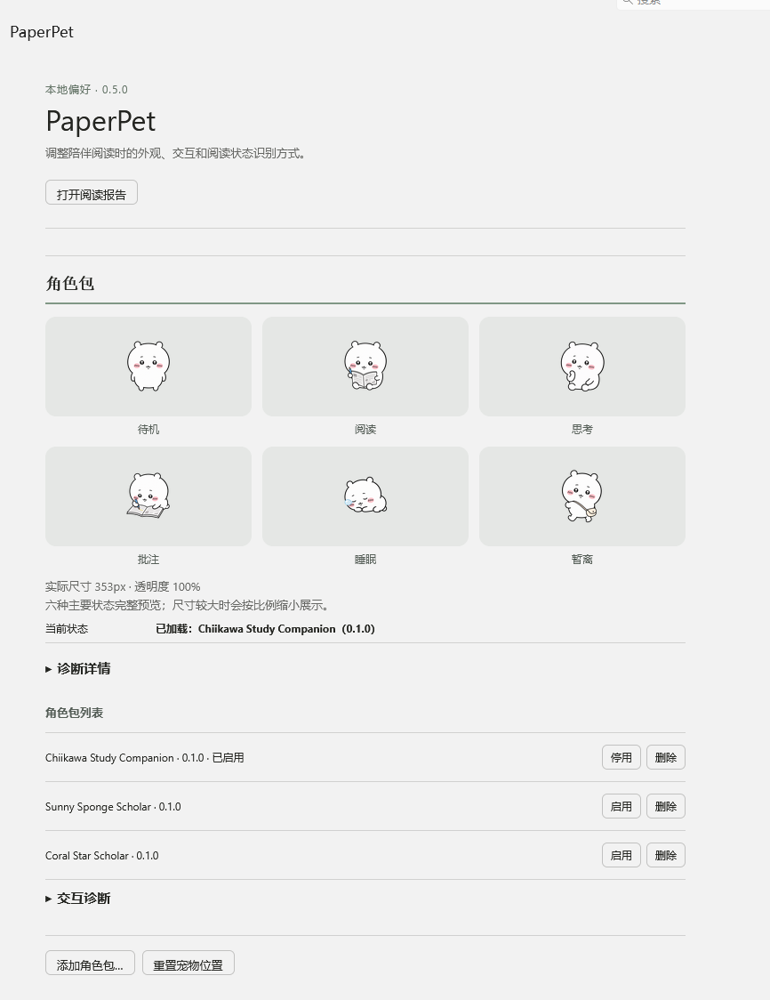
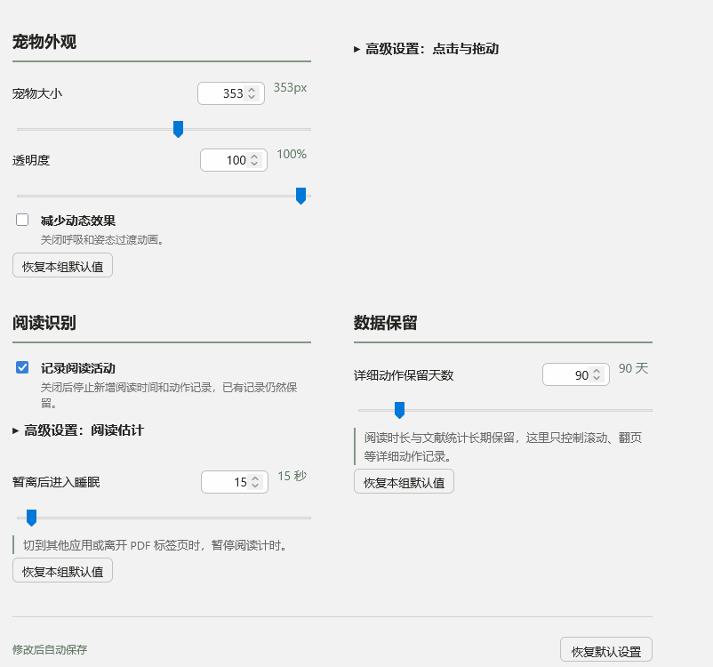
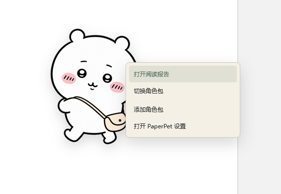

# PaperPet

让 Zotero 的每一次阅读，都有一个安静的陪伴。

PaperPet 是一款运行在 Zotero 桌面端的本地阅读伴侣。它会根据阅读器或笔记编辑器的前台状态、翻页、滚动、选区、批注、笔记编辑和停留等信号，判断当前更接近待机、阅读、思考、批注、暂离或睡眠中的哪一种状态，并把阅读过程整理成可回看的本地报告。

[下载最新版本](https://github.com/howarddong711/PaperPet/releases) · [查看全部版本](https://github.com/howarddong711/PaperPet/releases) · [提交问题](https://github.com/howarddong711/PaperPet/issues)

## 主要功能

- 在 Zotero 窗口内显示可拖动的阅读宠物，不遮挡 PDF 内容。
- 根据阅读行为在六种状态之间切换：待机、阅读、思考、批注、睡眠和暂离。
- 支持阅读和撰写 Zotero 原生笔记，包括文献库笔记、笔记标签页、阅读器侧栏和独立笔记窗口。
- 提供最近 30 天、最近 7 天和自定义日期范围的阅读报告。
- 使用日历热力图、每日趋势、阅读动作分布和识别比例帮助回看阅读过程。
- 在报告中查看文献标题、单篇文献详情和具体会话，并直接继续阅读。
- 支持修正会话：可以排除误触记录，也可以恢复被排除的会话。
- 支持 `.zpet` 声明式角色包，并提供安装、启用、停用、删除和状态预览。
- 支持宠物右键菜单，可快速打开报告、切换角色包、添加角色包或打开设置。
- 支持按范围备份和恢复阅读数据、设置与角色包。
- 所有阅读识别和数据统计都在本地完成。

## 界面预览

### 阅读报告

报告默认显示最近 30 天的数据，也可以切换到最近 7 天或自定义起止日期。页面顶部汇总估计阅读时长、阅读器前台时长、会话数量和阅读文献数量；下方提供热力图、每日趋势、最近阅读文献、识别比例和阅读动作分布。



报告中的文献列表会从 Zotero 条目实时解析标题。点击文献可以查看累计阅读、会话和动作详情，点击“继续阅读”可以直接重新打开对应附件或笔记。单篇详情和会话列表也支持继续阅读或排除误触记录。

报告还包含“统计说明”，解释有效阅读时长、阅读器前台时长和识别比例的计算口径。PaperPet 不设置效率评分、排行榜、连续签到或阅读目标，统计数据只用于回看自己的阅读过程。

### 设置页：角色包与诊断

设置页上半部分集中管理角色包和常用入口。这里可以打开阅读报告、查看六种状态预览、添加角色包，并在角色包列表中启用、停用或删除已经安装的角色包。预览会跟随当前启用的角色包实时更新。



“诊断详情”和“交互诊断”默认折叠，遇到角色包加载、文献标题解析或交互问题时可以展开查看路径、错误信息和最近事件。角色包文件只读取图片和 manifest，不执行角色包中的脚本。

### 设置页：外观、阅读识别与数据保留

设置页下半部分用于调整宠物外观和阅读识别。滑块旁边提供精确数值输入，修改会即时反映到宠物和预览中；每个设置分组都可以单独恢复默认值。



可以调整的内容包括：

- 宠物大小和透明度。
- 是否减少呼吸、姿态和过渡动画。
- 拖动判定距离和双击等待时间。
- 是否记录阅读活动。
- 阅读速度、无法识别文字页面的默认停留时间和暂离后进入睡眠的延迟。
- 详细滚动、翻页、选区和批注动作的保留天数。

设置修改会自动保存到本机。阅读数据不会通过设置页的数值控件手动改写，统计数据以插件从 Zotero 阅读过程采集的记录为准。

### 宠物右键菜单

左键点击宠物会在宠物左上方显示当前状态气泡；按住宠物可以拖动。右键可以打开快捷菜单：

1. **打开阅读报告**：直接打开 PaperPet 报告页。
2. **切换角色包**：展开已安装的角色包列表并切换当前角色。
3. **添加角色包**：选择并安装 `.zpet` 文件，安装后自动启用。
4. **打开 PaperPet 设置**：打开 Zotero 的 PaperPet 设置页。



菜单内部可以继续点击子菜单；点击菜单外部或将鼠标移出菜单区域后，菜单会自动关闭。

## 阅读陪伴如何工作

PaperPet 会在 Zotero 窗口内观察与阅读相关的本地 UI 信号：阅读器或笔记编辑器是否处于前台、页面是否发生滚动或翻页、是否有选区、批注或笔记编辑，以及可见文字和视口的变化。可见文字只用于本地估算停留时间，不会保存原文、输入内容或发送到外部服务，也不会阻止 Zotero 的正常操作。

宠物状态大致对应以下情况：

- **待机**：没有正在记录的阅读动作。
- **阅读**：检测到持续的前台阅读和页面内容变化。
- **思考**：阅读器仍处于前台，但动作暂时减少。
- **批注**：检测到选区、PDF 批注或笔记编辑动作。
- **暂离**：切换到其他应用，或离开文献和笔记阅读区域。
- **睡眠**：暂离或无阅读信号达到设置的延迟后进入休息状态。

这些状态是对阅读过程的轻量估计，不是对注意力或学习效率的判断。

### 阅读和撰写笔记

在 Zotero 原生笔记编辑器中打开笔记后，阅读、滚动、选区、输入、中文输入法提交、粘贴和格式编辑都会参与活动识别。阅读笔记会显示阅读或思考状态；编辑笔记会使用已有的“批注”动作。仅打开文献库列表、查看报告或切换到其他应用，不会继续增加有效阅读时长；长时间没有信号仍会正常休息。

论文下的笔记会关联到父文献；独立笔记使用自身标题单独记录。PDF 和笔记保留各自的来源与会话，同一时刻只对当前阅读或编辑的内容计时。“继续阅读”会重新打开记录对应的附件或笔记。笔记编辑单独记录为“笔记编辑”动作，不会把每次输入算成一条 PDF 批注，自动保存也不会被当成持续编辑。新建笔记在 Zotero 首次保存并生成条目 key 后才开始形成可关联的会话。

报告总览、文献详情、会话记录、每日图表提示以及宠物状态气泡会展示“笔记编辑时长”。它是有效阅读时长中的一部分，不会与阅读时长重复相加；阅读笔记仍归入有效阅读，但不会单独启动编辑计时。

编辑计时由实际输入、中文输入法提交、粘贴、撤销或格式修改启动，保留最多 15 秒的无输入短暂停顿；连续 15 秒没有编辑、切换内容或离开前台就暂停，返回后需再次编辑。该值采用与有效阅读相同的置信度加权，是编辑活动的估计时长，不是逐个按键的精确时间。滚动、选中文字和自动保存不会启动编辑计时，也不会记录输入正文。历史数据无法倒推出编辑时长，升级后从零开始累计此项；原有阅读记录保留，旧版备份仍可导入。

## 阅读报告与数据管理

### 日期范围与统计

报告支持以下范围：

- 最近 30 天：默认范围，适合查看近期阅读节奏。
- 最近 7 天：适合快速查看本周阅读情况。
- 自定义日期：选择开始日期和结束日期，最多查询 366 天。

报告按照会话开始日期归档，只统计未删除、未排除的会话。会话可以在文献详情中排除或恢复，恢复后相关汇总、热力图和动作统计会立即刷新。

### 备份与恢复

报告页的“数据管理”菜单提供三种范围：

- **阅读数据**：阅读会话、文献汇总和动作事件。
- **设置与角色包**：PaperPet 设置、已安装角色包的 manifest 和相关状态。
- **完整备份**：同时包含以上两类数据。

备份文件是本地 JSON。导入前会明确提示将替换的范围；阅读数据和设置/角色包可以分别恢复，不需要覆盖另一部分数据。PaperPet 不提供“清空记录”快捷入口，避免误删本地阅读历史。

## 角色包

PaperPet 使用声明式的 `.zpet` 角色包。一个角色包包含 `manifest.json` 和六种状态对应的图片资源，角色的图片、动作状态、尺寸和展示规则彼此分离。安装器会检查文件结构、版本、资源路径、图片尺寸和压缩包大小，不执行角色包中的脚本。

角色包可以从设置页的“添加角色包”按钮或宠物右键菜单安装。安装后可在设置页角色包列表中启用、停用和删除，也可以从右键菜单快速切换已安装角色包。

- [角色包格式说明](docs/character-pack.schema.json)
- [自定义角色包指南](docs/character-pack-creation.md)
- [示例角色包说明](examples/character-packs/README.md)
- [Chiikawa Study Companion 示例包](examples/character-packs/chiikawa-study-companion.zpet)

仓库中的示例包包含待机、阅读、思考、批注、睡眠和暂离六种静态动作：

<table>
  <tr>
    <td align="center" width="33%">
      
      <br />待机 <code>idle</code>
    </td>
    <td align="center" width="33%">
      
      <br />阅读 <code>reading</code>
    </td>
    <td align="center" width="33%">
      
      <br />思考 <code>thinking</code>
    </td>
  </tr>
  <tr>
    <td align="center" width="33%">
      
      <br />批注 <code>annotating</code>
    </td>
    <td align="center" width="33%">
      
      <br />睡眠 <code>sleeping</code>
    </td>
    <td align="center" width="33%">
      
      <br />暂离 <code>away</code>
    </td>
  </tr>
</table>

## 安装与开始使用

PaperPet 0.4.0 起支持 Zotero 10 桌面端，PaperPet 0.5.1 适用于 Zotero 10.x 的 macOS、Windows 和 Linux。Zotero 9 用户请继续使用 PaperPet 0.3.11。

1. 从 [GitHub Releases](https://github.com/howarddong711/PaperPet/releases) 下载最新的 `PaperPet.xpi`。
2. 打开 Zotero，进入“工具 → 插件”。
3. 点击右上角齿轮按钮，选择“从文件安装插件”，再选择下载的 XPI 文件。
4. 安装完成后打开“Zotero → 设置 → PaperPet”。
5. 在设置页调整宠物大小、透明度和阅读识别参数；需要时添加角色包。
6. 在 Zotero 阅读器中打开文献，或打开原生笔记阅读、撰写，PaperPet 会开始记录会话。
7. 从设置页的“打开阅读报告”按钮或宠物右键菜单查看统计结果。

更新插件时，直接安装新版本的 `PaperPet.xpi` 即可。阅读数据、设置和已安装角色包保存在 Zotero 数据目录中，不会因为更新插件本体而自动清除。

## 数据与隐私

PaperPet 的阅读会话、动作事件、设置和报告数据默认只保存在 Zotero 数据目录下的本地 SQLite 数据库中。当前版本不提供云同步，也不会把论文标题、全文、划线或笔记发送到外部服务。

报告中的“有效阅读时间”是根据前台阅读器或笔记编辑器时间、可见文字采样、滚动、翻页、选区、批注和笔记编辑等信号估计出的过程近似值。它不等同于眼动仪测得的注视时间，也不承担效率评分的作用。统计结果可能受到窗口切换、文档结构和 Zotero 编辑器状态的影响。

## 常见问题

### 宠物为什么会睡着

PaperPet 会根据最近一段时间的阅读动作判断你是否仍在阅读。停留、滚动、翻页、选区、批注和笔记编辑都会帮助它保持清醒；切到其他应用、离开文献与笔记区域或长时间没有信号时，它会进入暂离或睡眠状态。睡眠延迟和阅读识别参数可以在设置页调整。

### 宠物拖不动怎么办

请按住宠物本身的任意位置再移动鼠标。点击和拖动使用不同的判定阈值，轻点会触发互动，移动超过阈值后才会开始拖动。宠物位置会限制在当前 Zotero 窗口内。

### 角色包预览没有变化怎么办

启用或停用角色包后，设置页的六种预览会自动刷新。若设置页已经打开，切换后可以重新打开设置页；如果角色包加载失败，展开“诊断详情”查看安装路径和错误信息。

### 报告为什么没有文献标题

报告会优先从阅读记录关联的 Zotero 条目读取标题，也会尝试从附件的父条目读取标题。请确认对应条目仍存在于当前 Zotero 库中；如果标题查询失败，可以在设置页的“交互诊断”中查看最近一次查询结果。

### 报告为什么还是空的

需要先在 Zotero 阅读器中打开文献，或在原生笔记编辑器中阅读、撰写笔记。PaperPet 会在会话有足够信号后定期整理记录，刚开始阅读时报告可能仍显示为零。

### 可以删除或备份记录吗

可以。在阅读报告的“数据管理”菜单中按范围备份或导入本地 JSON 阅读数据、设置与角色包。为了避免误操作，当前版本没有清空全部记录的快捷按钮；需要修正单条误触记录时，可以在文献详情中排除或恢复会话。

## 当前版本

PaperPet 0.5.1 支持 Zotero 10，并加入自定义日期范围、日历热力图、报告内继续阅读、会话修正、角色包管理、分离备份、统计说明和交互诊断，同时支持阅读并编辑 Zotero 原生笔记、单独查看笔记编辑时长。日报、周报、月报和年报不属于当前版本；后续功能会继续以本地优先和不打扰阅读为原则设计。

## 开发与验证

本仓库使用 TypeScript 构建 Zotero 插件。常用命令如下：

```powershell
npm install
npm run typecheck
npm test
npm run lint
npm run build
```

生产构建会在 `.scaffold/build/` 生成 `PaperPet.xpi`。提交问题时，请附上 Zotero 版本、操作系统、PaperPet 版本、复现步骤，以及设置页诊断面板中的相关信息；不要上传包含个人文献数据的备份文件。

## 许可

当前仓库尚未附加开源许可证。除 GitHub 正常浏览、下载与安装本项目发布包外，不授予复制、修改或再分发源码的许可。
